# Sprint 3

## Sprint Planning

Durante el Sprint 3 se continuará el desarrollo de la Plataforma Web/Móvil para Gestión de Eventos y Congresos con Inteligencia Artificial, tomando como base la arquitectura multi-tenant, autenticación JWT, usuarios, roles, gestión de eventos y programación implementada en el Sprint 1, así como los módulos de inscripciones, postulaciones y asignaciones de staff desarrollados en el Sprint 2.

En este Sprint el trabajo se concentrará principalmente en las funcionalidades críticas de control de acceso, acreditación digital mediante códigos QR firmados criptográficamente, registro de asistencia (Check-in) en tiempo real, monitoreo de aforo por sala, notificaciones y recordatorios transaccionales automatizados (vía Brevo), y la consulta del historial consolidado de participación del usuario.

Los casos de uso seleccionados para este Sprint son:
- **CU21**: Generar y visualizar credencial digital con QR
- **CU22**: Escanear y validar código QR
- **CU23**: Registrar asistencia (Check-in)
- **CU24**: Consultar asistencia y aforo en tiempo real
- **CU25**: Gestionar recordatorios y notificaciones
- **CU27**: Consultar historial de participación

### Objetivo del Sprint

El objetivo del Sprint 3 será desarrollar e integrar las funcionalidades relacionadas con la emisión de credenciales digitales seguras con QR, la verificación y validación de acceso en puertas por parte del personal de Staff autorizado, el registro de asistencia sin duplicidad, el seguimiento de aforo en vivo mediante WebSockets para organizadores, la automatización de recordatorios y alertas por correo electrónico a través de la integración con Brevo, y el acceso al historial de participación para los asistentes registrados.

Durante este Sprint se implementará la generación dinámica del token QR basado en HMAC-SHA256, garantizando que las credenciales sean infalsificables y permitan la verificación tanto online como en contingencia offline por la aplicación móvil Flutter.

Asimismo, se desarrollará el mecanismo de Check-in con control estricto antifraude (bloqueo automático ante intentos de reutilización de credenciales en múltiples puertas), junto con la sincronización bidireccional hacia la bitácora auditable cifrada y el aislamiento estricto de datos por tenant organizacional.

Las funcionalidades desarrolladas serán integradas de forma transversal con el backend Spring Boot 3, la plataforma web Angular 20, la base de datos PostgreSQL 17 y la aplicación móvil Flutter. El incremento obtenido será desplegado progresivamente sobre la infraestructura en la nube AWS y contenedores Docker para validar la operabilidad integral.

### Historias de usuario (tarjetas 3C, Planning póker, prototipos)

#### CU21: Generación y Visualización de Credencial Digital QR

| Generación y Visualización de Credencial Digital QR | |
|---|---|
| **ID : 21** | **Descripción**: Generar y visualizar la credencial digital con código QR dinámico y firmado para participantes con inscripción confirmada. |
| **Prioridad**: Alta | **Estimación PHU**: 8hr |
| **Criterios de aceptación**:<br>• El participante autenticado con inscripción CONFIRMADA debe poder generar su credencial digital desde la app móvil Flutter y la web Angular.<br>• La credencial debe desplegar nombre completo, evento, categoría de inscripción, fecha y el código QR visualmente legible.<br>• El código QR debe codificar un token criptográfico firmado (HMAC-SHA256) que prevenga falsificaciones o alteraciones de identidad.<br>• El sistema debe permitir descargar la credencial en PDF o almacenarla en la caché local (Wallet offline) para acceso sin conexión.<br>• Si la inscripción se encuentra cancelada, rechazada o pendiente de pago, el sistema no emitirá el código QR activo. | |
| **Desarrollador a cargo**: Aranibar Pérez Kevin Ariel / Cervantes Arancibia Roberto Carlos | |

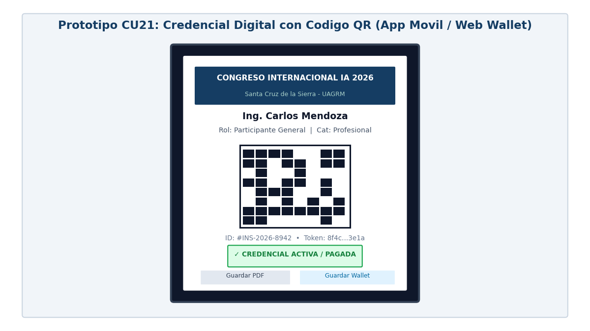

---

#### CU22: Escaneo y Validación de Código QR

| Escaneo y Validación de Código QR | |
|---|---|
| **ID : 22** | **Descripción**: Escanear y validar la credencial QR en los puntos de acceso mediante la cámara de la aplicación móvil del Staff autorizado. |
| **Prioridad**: Alta | **Estimación PHU**: 8hr |
| **Criterios de aceptación**:<br>• El personal de Staff autenticado y asignado al evento debe poder activar la cámara desde la app móvil Flutter para escanear credenciales.<br>• El sistema debe decodificar el QR y validar la firma criptográfica y vigencia del token en menos de 1 segundo.<br>• La pantalla debe mostrar una alerta clara con retroalimentación inmediata: 'Acreditado / Válido', 'QR Inválido' o 'Evento Incorrecto'.<br>• Debe soportar validación offline en caso de intermitencia de red contra la lista local sincronizada de inscritos.<br>• Usuarios sin rol Staff o fuera del horario programado del evento tendrán el acceso al módulo de escaneo bloqueado. | |
| **Desarrollador a cargo**: Espinoza Sanchez Matteo | |

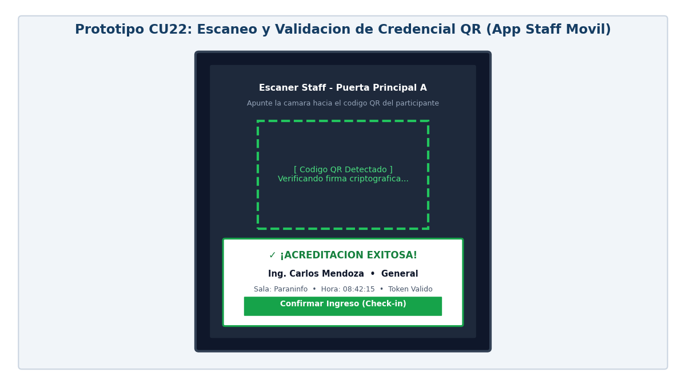

---

#### CU23: Registro de Asistencia (Check-in)

| Registro de Asistencia (Check-in) | |
|---|---|
| **ID : 23** | **Descripción**: Registrar el ingreso efectivo del participante en la base de datos garantizando control estricto de duplicidad y contingencia manual. |
| **Prioridad**: Alta | **Estimación PHU**: 8hr |
| **Criterios de aceptación**:<br>• Tras el escaneo exitoso, el sistema registrará la asistencia con marca de tiempo precisa (timestamp) y el ID del operador Staff.<br>• El sistema impedirá check-in duplicados para la misma sesión o evento, emitiendo una alerta roja con la hora y puerta del ingreso previo.<br>• Debe proveer una opción de registro manual de asistencia por documento de identidad (CI/DNI) o correo para contingencias.<br>• Cada registro exitoso o intento denegado debe asentar un evento en la bitácora cifrada asociada al tenant correspondiente.<br>• El estado de la inscripción del participante debe actualizarse de forma inmediata a 'Asistió / Presente'. | |
| **Desarrollador a cargo**: Cervantes Arancibia Roberto Carlos | |

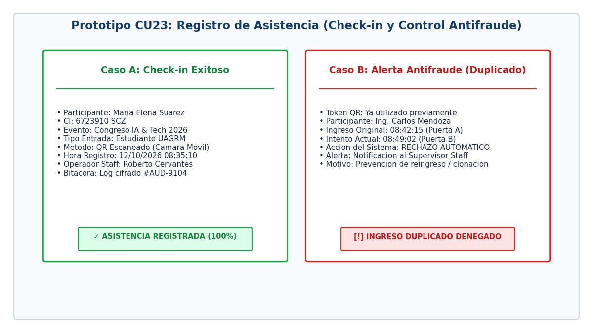

---

#### CU24: Consulta de Asistencia y Aforo en Tiempo Real

| Consulta de Asistencia y Aforo en Tiempo Real | |
|---|---|
| **ID : 24** | **Descripción**: Supervisar en tiempo real el porcentaje de asistencia, conteo de ingresos y nivel de aforo por sala mediante dashboard web reactivo. |
| **Prioridad**: Alta | **Estimación PHU**: 8hr |
| **Criterios de aceptación**:<br>• El organizador y administrador deben visualizar un dashboard web en Angular con el total de inscritos, asistentes presentes y ausentes.<br>• El conteo de asistentes y porcentajes de ocupación por sala deben actualizarse en vivo mediante conexión WebSocket / STOMP.<br>• El sistema debe desplegar alertas visuales automáticas cuando el aforo alcance umbrales críticos (80%, 90% y 100% de la capacidad).<br>• Debe permitir aplicar filtros por sala, categoría de entrada y franja horaria de ingreso.<br>• Debe permitir exportar la nómina de asistencia en formatos estándar (CSV y PDF) para control administrativo. | |
| **Desarrollador a cargo**: Choque Canavides Cristian Santiago | |

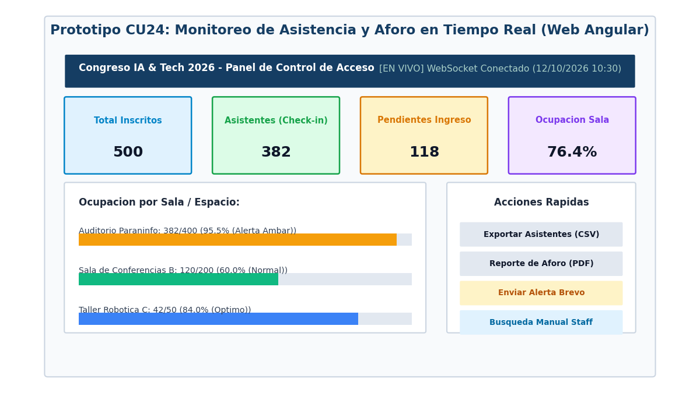

---

#### CU25: Gestión de Recordatorios y Notificaciones

| Gestión de Recordatorios y Notificaciones | |
|---|---|
| **ID : 25** | **Descripción**: Automatizar el despacho de correos transaccionales y recordatorios mediante Brevo para confirmación, alertas de horario y credenciales. |
| **Prioridad**: Alta | **Estimación PHU**: 8hr |
| **Criterios de aceptación**:<br>• El sistema enviará de forma automática un correo electrónico transaccional con la credencial digital y QR tras confirmarse la inscripción.<br>• Debe permitir programar recordatorios masivos previos al evento (24h y 2h antes) informando ubicación, sala y requisitos de acceso.<br>• Debe emitir avisos inmediatos ante eventuales reprogramaciones, cambios de sala o cancelaciones de conferencias.<br>• Cada notificación despachada debe registrarse en la base de datos con su estado de entrega ('ENVIADO', 'PENDIENTE', 'FALLIDO').<br>• La integración debe operar mediante la API REST transaccional de Brevo garantizando aislamiento multi-tenant por organización. | |
| **Desarrollador a cargo**: Justiniano Coimbra Raúl Rodrigo | |

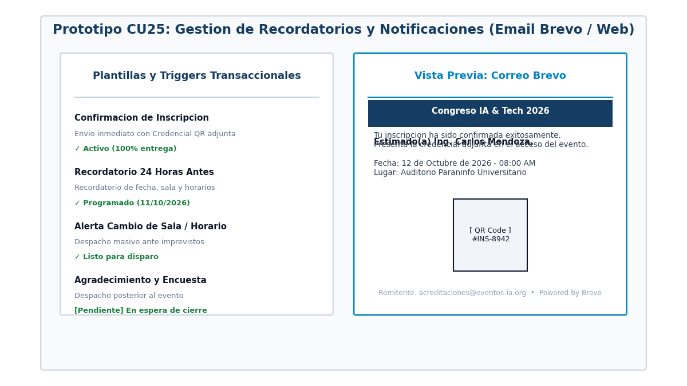

---

#### CU27: Consulta de Historial de Participación

| Consulta de Historial de Participación | |
|---|---|
| **ID : 27** | **Descripción**: Permitir a los participantes consultar su trayectoria histórica de eventos asistidos, credenciales y constancias desde móvil o web. |
| **Prioridad**: Media | **Estimación PHU**: 7hr |
| **Criterios de aceptación**:<br>• El usuario autenticado debe acceder a la lista cronológica de todos los eventos en los que se ha inscrito (vigentes y pasados).<br>• Para cada evento debe detallar: fecha, título, organización organizadora, modalidad, estado de inscripción y asistencia registrada.<br>• Debe permitir descargar o visualizar la credencial digital para eventos activos o próximos a iniciar.<br>• La información desplegada debe estar estrictamente protegida y restringida al titular de la cuenta autenticada.<br>• La interfaz debe incorporar filtros de búsqueda por nombre de evento, rango de fechas y condición de asistencia. | |
| **Desarrollador a cargo**: Choque Canavides Cristian Santiago / Aranibar Pérez Kevin Ariel | |

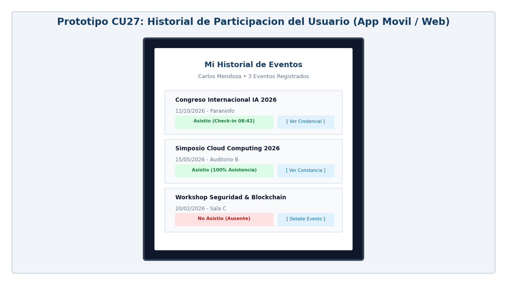

---

### Contexto del Sistema

Durante el Sprint 3 se amplía la estructura funcional consolidada en los sprints precedentes, integrando el flujo operativo de control de acceso físico y virtual de los eventos. Mientras el Sprint 0 definió la arquitectura base y autenticación, el Sprint 1 la gestión de eventos y salas, y el Sprint 2 las inscripciones y postulación de staff, el Sprint 3 concreta el día del evento mediante el uso de tecnología móvil y mensajería transaccional.

El desarrollo se enfoca inicialmente en el motor de generación y firma de credenciales QR dinámicas, asegurando que cada token contenga información cifrada e incorruptible vinculada a la inscripción del participante.

Posteriormente se incorpora la aplicación móvil para el personal de Staff, transformando los dispositivos en terminales ópticos de escaneo capaces de validar credenciales en milisegundos y registrar el check-in de asistencia directamente en el backend.

Asimismo, se habilita el monitoreo reactivo de aforo mediante WebSockets en la consola web Angular, permitiendo a los organizadores tomar decisiones logísticas en tiempo real basadas en la ocupación física de los auditorios.

El Sprint incluye además el despacho masivo y automatizado de comunicaciones a través del servicio en la nube Brevo, asegurando que los inscritos reciban oportunamente sus credenciales y recordatorios de inicio.

Todas estas funcionalidades operan bajo las directivas de seguridad multi-tenant establecidas, garantizando que los datos de asistencia y acreditaciones pertenezcan exclusivamente a la organización responsable y queden asentados en la bitácora cifrada.

### Sprint Backlog

| Sprint Backlog | | | | | |
|---|---|---|---|---|---|
| **Número de Sprint : 3** | | | **Tiempo programado: 5 días** | | |
| **Objetivo**: Desarrollar e integrar las funcionalidades de emisión de credenciales digitales con QR, escaneo y validación en app móvil para Staff, registro de asistencia Check-in sin duplicados, monitoreo de aforo en tiempo real vía WebSockets, gestión de recordatorios y notificaciones automáticas con Brevo, y consulta del historial de participación del usuario. | | | | | |
| **Product Owner**: Cervantes Arancibia Roberto Carlos | | | | | |
| **Fecha de inicio**: 12/10/2026 | | | **Fecha de finalización**: 16/10/2026 | | |
| **Id** | **Tarea** | **Tipo** | **Estimación (hr)** | **Responsable** | **Estado** |
| SP3-1 | Diseñar credencial digital con QR | Diseño | 4hr | Aranibar Pérez Kevin Ariel | Terminado |
| SP3-2 | Generar códigos QR asociados a inscripciones | Desarrollo | 7hr | Cervantes Arancibia Roberto Carlos | Terminado |
| SP3-3 | Visualizar credencial QR en app móvil y web | Desarrollo | 6hr | Aranibar Pérez Kevin Ariel | Terminado |
| SP3-4 | Probar generación y visualización QR | Pruebas | 3hr | Carvallo Andreu Carlos Rodrigo | Terminado |
| SP3-5 | Diseñar escaneo y validación QR para Staff | Diseño | 4hr | Aranibar Pérez Kevin Ariel | Terminado |
| SP3-6 | Implementar escaneo y validación QR en móvil | Desarrollo | 8hr | Espinoza Sanchez Matteo | Terminado |
| SP3-7 | Probar control de acceso y validación QR | Pruebas | 4hr | Carvallo Andreu Carlos Rodrigo | Terminado |
| SP3-8 | Implementar registro de asistencia y antifraude | Desarrollo | 8hr | Cervantes Arancibia Roberto Carlos | Terminado |
| SP3-9 | Diseñar seguimiento web de asistencia y aforo | Diseño | 4hr | Choque Canavides Cristian Santiago | Terminado |
| SP3-10 | Consultar asistencia y aforo en tiempo real (WebSocket) | Desarrollo | 8hr | Choque Canavides Cristian Santiago | Terminado |
| SP3-11 | Probar asistencia y monitoreo de aforo en vivo | Pruebas | 4hr | Carvallo Andreu Carlos Rodrigo | Terminado |
| SP3-12 | Diseñar recordatorios y plantillas de notificación | Diseño | 4hr | Choque Canavides Cristian Santiago | Terminado |
| SP3-13 | Implementar notificaciones de inscripción con Brevo | Desarrollo | 6hr | Justiniano Coimbra Raúl Rodrigo | Terminado |
| SP3-14 | Implementar recordatorios, cambios y cancelaciones | Desarrollo | 6hr | Justiniano Coimbra Raúl Rodrigo | Terminado |
| SP3-15 | Probar despacho de notificaciones y emails | Pruebas | 3hr | Carvallo Andreu Carlos Rodrigo | Terminado |
| SP3-16 | Diseñar historial de participación del usuario | Diseño | 4hr | Aranibar Pérez Kevin Ariel | Terminado |
| SP3-17 | Implementar historial de inscripciones y asistencias | Desarrollo | 7hr | Choque Canavides Cristian Santiago | Terminado |
| SP3-18 | Probar historial y trazabilidad de participación | Pruebas | 4hr | Carvallo Andreu Carlos Rodrigo | Terminado |

### Equipo Scrum

| ROL | PERSONA |
|---|---|
| Product Owner | Cervantes Arancibia Roberto Carlos |
| Scrum Máster | Espinoza Sanchez Matteo |
| Developer | Carvallo Andreu Carlos Rodrigo |
| Developer | Choque Canavides Cristian Santiago |
| Developer | Justiniano Coimbra Raúl Rodrigo |
| Developer | Aranibar Pérez Kevin Ariel |

---

## Proceso/patrón de desarrollo por Historia de Usuario

### Diseño

#### Diseño De La Arquitectura

##### Diseño Físico: Diagrama de Despliegue en AWS Cloud Multi-Tenant

El siguiente diagrama de despliegue representa la topología de infraestructura en la nube de Amazon Web Services (AWS) para la plataforma multi-tenant. Modela la interacción entre los dispositivos cliente (App Móvil Flutter para Wallet QR y escáner Staff, y Navegador Web para la SPA de Angular 20) accediendo de manera segura mediante TLS 443 / WSS hacia un Application Load Balancer (ALB). Dentro de la VPC de AWS se ejecuta el clúster de cómputo (EC2/ECS Docker) con los contenedores del backend Spring Boot 3 (Java 21) y el microservicio de IA FastAPI (Python 3.11), comunicados con la base de datos relacional Amazon RDS PostgreSQL 17 multi-tenant con esquemas aislados por tenant, AWS KMS para el sellado criptográfico de la bitácora, Amazon S3 para assets y reportes, y servicios externos como Brevo Cloud API (SMTP) y Stripe API.

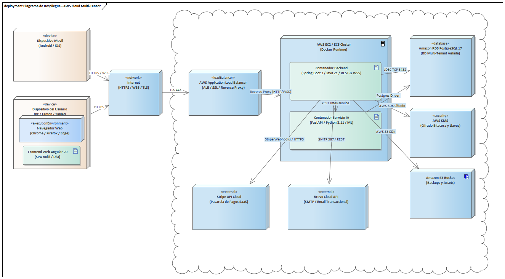

##### Diseño Lógico: Diagrama de Paquetes de la Arquitectura

El diagrama de paquetes modela la arquitectura lógica en capas desacopladas y modulares del sistema. Estructura la Capa de Presentación (Angular 20 y Flutter), el módulo transversal de Seguridad y Control de Acceso (JWT, Roles), la Gestión SaaS y Multi-Tenant, el Dominio Funcional del núcleo (Eventos y Espacios del Sprint 1, Inscripciones y Staff del Sprint 2, Acreditación / QR / Check-in del Sprint 3 y Notificaciones / Recordatorios del Sprint 3), los Servicios de Soporte (Servicio de IA FastAPI y Auditoría con Bitácora Cifrada por Tenant) y la Capa de Persistencia relacional (PostgreSQL 17, JPA).

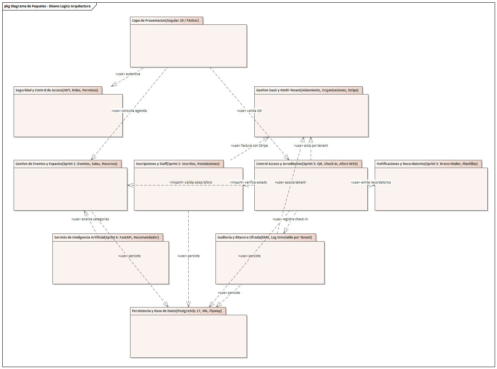

##### Diagrama de Componentes del Sprint 3

Durante el Sprint 3 se mantiene y expande la arquitectura hexagonal multi-tenant desarrollada en los sprints anteriores. El siguiente diagrama representa los componentes funcionales, clientes web/móviles, capas de servicio, mecanismos de WebSocket reactivos, persistencia en PostgreSQL y la integración externa con el servicio en la nube Brevo.

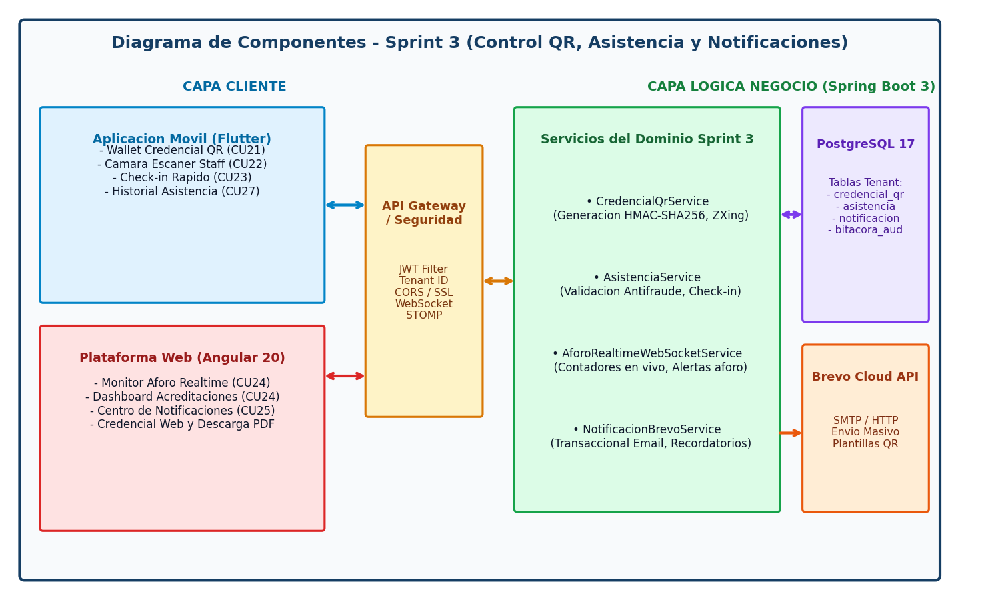

#### Diseño De Datos

**Diagrama De Clases / Datos del Sprint 3**

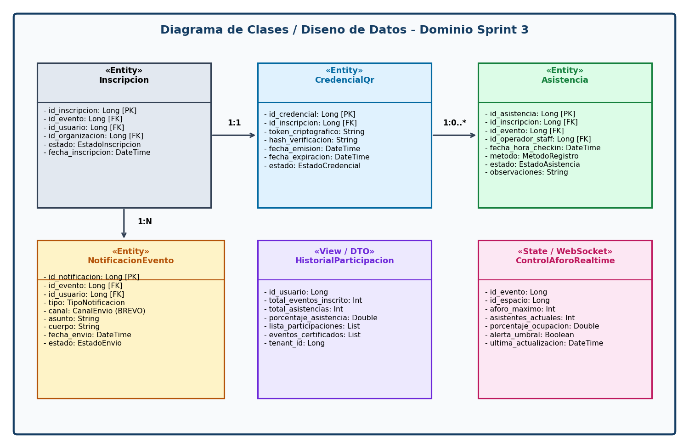

**Script DDL:**

```sql
-- SPRINT 3: CONTROL QR, ASISTENCIA, NOTIFICACIONES E HISTORIAL

CREATE TABLE credenciales_qr (
    id_credencial SERIAL PRIMARY KEY,
    id_inscripcion INT NOT NULL UNIQUE REFERENCES inscripciones(id_inscripcion) ON DELETE CASCADE,
    id_organizacion INT NOT NULL REFERENCES organizaciones(id_organizacion) ON DELETE CASCADE,
    token_criptografico VARCHAR(255) NOT NULL UNIQUE,
    hash_verificacion VARCHAR(64) NOT NULL,
    formato_qr VARCHAR(20) DEFAULT 'PNG_BASE64',
    fecha_emision TIMESTAMP NOT NULL DEFAULT CURRENT_TIMESTAMP,
    fecha_expiracion TIMESTAMP NOT NULL,
    estado VARCHAR(20) DEFAULT 'ACTIVA' CHECK (estado IN ('ACTIVA', 'REVOCADA', 'EXPIRADA'))
);

CREATE TABLE asistencias (\n
    id_asistencia SERIAL PRIMARY KEY,
    id_inscripcion INT NOT NULL REFERENCES inscripciones(id_inscripcion) ON DELETE CASCADE,
    id_evento INT NOT NULL REFERENCES eventos(id_evento) ON DELETE CASCADE,
    id_usuario INT NOT NULL REFERENCES usuarios(id_usuario) ON DELETE CASCADE,
    id_operador_staff INT REFERENCES usuarios(id_usuario) ON DELETE SET NULL,
    id_organizacion INT NOT NULL REFERENCES organizaciones(id_organizacion) ON DELETE CASCADE,
    fecha_hora_checkin TIMESTAMP NOT NULL DEFAULT CURRENT_TIMESTAMP,
    metodo_validacion VARCHAR(30) NOT NULL CHECK (metodo_validacion IN ('QR_ESCANEO', 'MANUAL_STAFF', 'OFFLINE_SYNC')),
    estado_asistencia VARCHAR(20) DEFAULT 'PRESENTE' CHECK (estado_asistencia IN ('PRESENTE', 'TARDANZA', 'JUSTIFICADO')),
    observaciones VARCHAR(255),
    CONSTRAINT uq_asistencia_evento_usuario UNIQUE (id_evento, id_usuario)
);

CREATE TABLE notificaciones_eventos (
    id_notificacion SERIAL PRIMARY KEY,
    id_evento INT NOT NULL REFERENCES eventos(id_evento) ON DELETE CASCADE,
    id_usuario INT NOT NULL REFERENCES usuarios(id_usuario) ON DELETE CASCADE,
    id_organizacion INT NOT NULL REFERENCES organizaciones(id_organizacion) ON DELETE CASCADE,
    tipo_notificacion VARCHAR(50) NOT NULL,
    canal_envio VARCHAR(20) NOT NULL DEFAULT 'EMAIL_BREVO',
    asunto VARCHAR(150) NOT NULL,
    cuerpo_mensaje TEXT NOT NULL,
    fecha_programada TIMESTAMP NOT NULL DEFAULT CURRENT_TIMESTAMP,
    fecha_envio TIMESTAMP,
    estado_envio VARCHAR(20) DEFAULT 'PENDIENTE' CHECK (estado_envio IN ('PENDIENTE', 'ENVIADO', 'FALLIDO')),
    id_mensaje_externo VARCHAR(100)
);

CREATE TABLE control_aforo_salas (
    id_control_aforo SERIAL PRIMARY KEY,
    id_evento INT NOT NULL REFERENCES eventos(id_evento) ON DELETE CASCADE,
    id_espacio INT NOT NULL REFERENCES espacios(id_espacio) ON DELETE CASCADE,
    capacidad_maxima INT NOT NULL CHECK (capacidad_maxima > 0),
    asistentes_actuales INT NOT NULL DEFAULT 0 CHECK (asistentes_actuales >= 0),
    porcentaje_ocupacion NUMERIC(5,2) GENERATED ALWAYS AS ((asistentes_actuales::numeric / capacidad_maxima::numeric) * 100) STORED,
    alerta_umbral BOOLEAN DEFAULT FALSE,
    ultima_actualizacion TIMESTAMP NOT NULL DEFAULT CURRENT_TIMESTAMP,
    CONSTRAINT uq_evento_espacio UNIQUE (id_evento, id_espacio)
);

CREATE INDEX idx_credencial_token ON credenciales_qr(token_criptografico);
CREATE INDEX idx_asistencias_evento_usuario ON asistencias(id_evento, id_usuario);
CREATE INDEX idx_notificaciones_estado ON notificaciones_eventos(estado_envio);
```

**Mapeo del Diccionario de Datos:**

| CREDENCIAL_QR |
|---|
| PK: id_credencial \| FK: id_inscripcion \| FK: id_organizacion \| token_criptografico \| hash_verificacion \| formato_qr \| fecha_emision \| fecha_expiracion \| estado |

| ASISTENCIA |
|---|
| PK: id_asistencia \| FK: id_inscripcion \| FK: id_evento \| FK: id_usuario \| FK: id_operador_staff \| FK: id_organizacion \| fecha_hora_checkin \| metodo_validacion \| estado_asistencia \| observaciones |

| NOTIFICACION_EVENTO |
|---|
| PK: id_notificacion \| FK: id_evento \| FK: id_usuario \| FK: id_organizacion \| tipo_notificacion \| canal_envio \| asunto \| cuerpo_mensaje \| fecha_programada \| fecha_envio \| estado_envio \| id_mensaje_externo |

| CONTROL_AFORO_SALA |
|---|
| PK: id_control_aforo \| FK: id_evento \| FK: id_espacio \| capacidad_maxima \| asistentes_actuales \| porcentaje_ocupacion \| alerta_umbral \| ultima_actualizacion |

| HISTORIAL_PARTICIPACION (VISTA) |
|---|
| PK: id_usuario \| total_eventos_inscrito \| total_asistencias_efectivas \| porcentaje_asistencia_global \| eventos_vigentes \| eventos_finalizados \| tenant_id |

#### Diseño De La Lógica De Negocio

**Diagrama de comunicación CU21: Generar y visualizar credencial digital con QR**
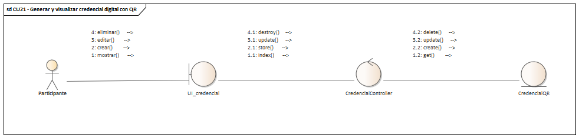

**Diagrama de comunicación CU22: Escanear y validar código QR**
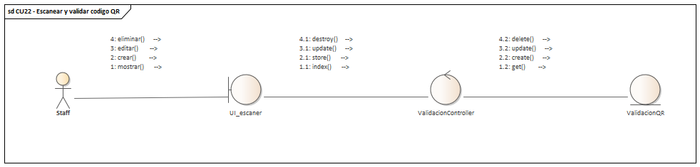

**Diagrama de comunicación CU23: Registrar asistencia (Check-in)**
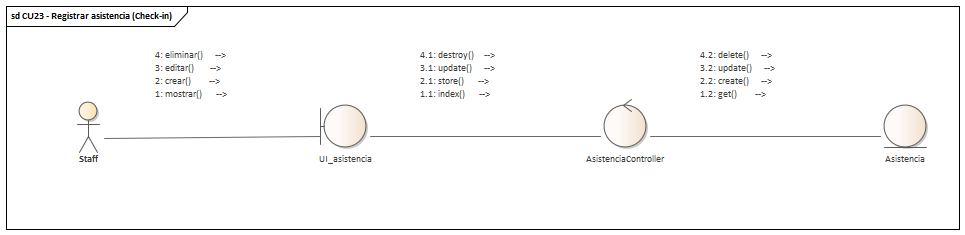

**Diagrama de comunicación CU24: Consultar asistencia y aforo en tiempo real**
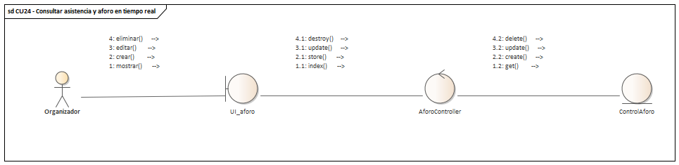

**Diagrama de comunicación CU25: Gestionar recordatorios y notificaciones**
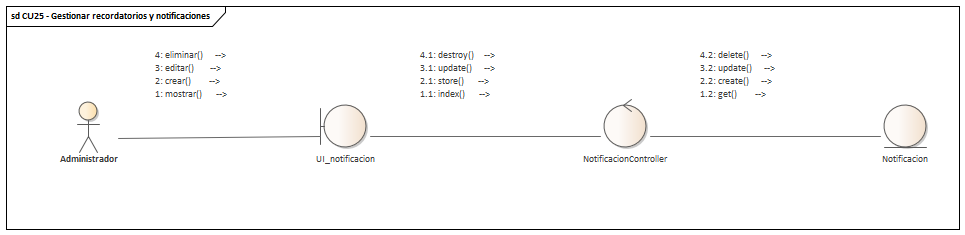

**Diagrama de comunicación CU27: Consultar historial de participación**
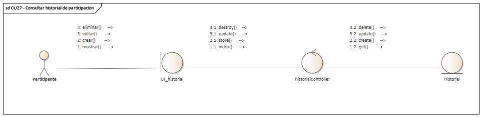

---

### Implementación

#### Componentes y artefactos generados

Durante la implementación del Sprint 3 se desarrollaron e integraron los componentes necesarios para el control de acceso digital, validación por escáner óptico, monitoreo de aforo en vivo, notificaciones transaccionales e historial de participación.

- **Plataforma web Angular**: módulo reactivo de monitoreo de aforo con gráficos en vivo, modal visor de credencial digital con descarga en PDF, consola de registro manual para Staff y centro de gestión de notificaciones.
- **Aplicación Flutter**: visor de credenciales con almacenamiento en Wallet local (soporte offline), escáner de cámara integrado con validación instantánea de firma HMAC, confirmación háptica de check-in y pantalla de historial del participante.
- **Backend Spring Boot**: endpoints REST para emisión y validación de tokens QR, servicio de control de asistencia y antifraude, broker WebSocket con protocolo STOMP para difusión reactiva de aforo y cliente Brevo para mensajería.
- **PostgreSQL**: tablas relacionales con restricciones de no duplicidad, índices de alta velocidad para validación de tokens y aislamiento estricto por organización.
- **Integración transversal**: integración con autenticación, bitácora cifrada (KMS) y modelo multi-tenant consolidados en los Sprints 0, 1 y 2.
- **Despliegue cloud**: despliegue progresivo del incremento en la infraestructura AWS y Docker Compose garantizando sincronización continua.

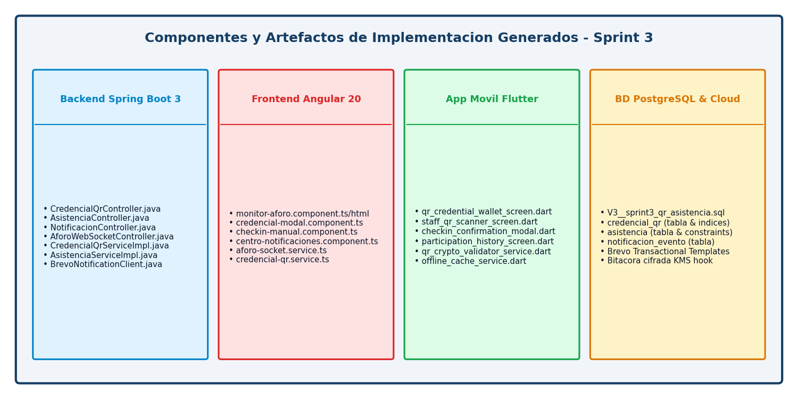

---

### Pruebas

#### Plan de pruebas (Criterios de aceptación )

Las pruebas del Sprint 3 tienen como finalidad verificar que las funcionalidades de acreditación QR, escaneo móvil, check-in de asistencia, aforo en tiempo real, notificaciones automáticas e historial de participación cumplan con los criterios de aceptación definidos para las historias de usuario seleccionadas.

##### Prueba 1: Generar y visualizar credencial digital con QR
| Campo | Descripción |
|---|---|
| **Código** | PT-S3-01 |
| **Historia de Usuario** | CU21: Generar y visualizar credencial digital con QR |
| **Descripción** | Validar la generación correcta del código QR criptográfico para participantes con inscripción confirmada y su visualización en web y móvil. |
| **Precondición** | Usuario participante con inscripción en estado CONFIRMADA o APROBADA. |
| **Pasos de prueba** | 1. Iniciar sesión como participante.<br>2. Navegar a 'Mis Inscripciones' o 'Mi Credencial'.<br>3. Solicitar generación de credencial digital.<br>4. Comprobar renderizado de código QR y datos del evento.<br>5. Descargar credencial en PDF y guardar en Wallet local. |
| **Resultado esperado** | La credencial digital se genera con token válido, el código QR es nítido y almacena el hash firmado HMAC-SHA256 sin errores. |
| **Resultado obtenido** | Ejecutado con éxito en web y móvil Flutter. Credencial generada y legible por escáner. |
| **Estado** | Aprobado |

##### Prueba 2: Escanear y validar código QR
| Campo | Descripción |
|---|---|
| **Código** | PT-S3-02 |
| **Historia de Usuario** | CU22: Escanear y validar código QR |
| **Descripción** | Validar la lectura óptica del QR mediante la app móvil Staff, comprobando la autenticidad del token y estado del participante. |
| **Precondición** | Usuario Staff autenticado con rol asignado y cámara del dispositivo móvil habilitada. |
| **Pasos de prueba** | 1. Iniciar sesión en la app móvil con cuenta Staff.<br>2. Abrir módulo 'Escáner de Acceso'.<br>3. Apuntar cámara hacia la credencial QR del participante.<br>4. Verificar tiempo de respuesta (< 1 seg) y datos desplegados. |
| **Resultado esperado** | El escáner decodifica el token, valida la firma criptográfica en menos de 1 segundo y despliega modal de confirmación con datos del asistente. |
| **Resultado obtenido** | Ejecutado con éxito. Tiempo promedio de respuesta: 320 ms. Firma validada. |
| **Estado** | Aprobado |

##### Prueba 3: Registrar asistencia (Check-in) y control antifraude
| Campo | Descripción |
|---|---|
| **Código** | PT-S3-03 |
| **Historia de Usuario** | CU23: Registrar asistencia (Check-in) |
| **Descripción** | Validar el registro efectivo de asistencia en la base de datos y comprobar el bloqueo estricto ante intentos de doble ingreso. |
| **Precondición** | Credencial QR válida y no utilizada previamente para el evento en curso. |
| **Pasos de prueba** | 1. Escanear QR válido y confirmar ingreso.<br>2. Verificar registro en BD y actualización de estado a 'PRESENTE'.<br>3. Re-escanear inmediatamente el mismo QR en otra puerta simulada.<br>4. Probar registro manual por número de documento (CI). |
| **Resultado esperado** | El primer check-in se asienta correctamente en BD y bitácora. El segundo intento es rechazado con alerta roja de 'Ingreso Duplicado'. El registro manual funciona como contingencia. |
| **Resultado obtenido** | Ejecutado con éxito. Restricción única en BD impidió duplicación. Alerta desplegada en pantalla. |
| **Estado** | Aprobado |

##### Prueba 4: Consultar asistencia y aforo en tiempo real
| Campo | Descripción |
|---|---|
| **Código** | PT-S3-04 |
| **Historia de Usuario** | CU24: Consultar asistencia y aforo en tiempo real |
| **Descripción** | Validar la recepción y actualización en vivo del porcentaje de aforo y conteo de asistentes mediante WebSockets en la web Angular. |
| **Precondición** | Usuario Organizador o Administrador conectado al panel de monitoreo web. |
| **Pasos de prueba** | 1. Acceder al dashboard de aforo del evento.<br>2. Ejecutar ingresos concurrentes de asistentes desde la app Staff.<br>3. Observar la actualización automática de métricas sin recargar el navegador.<br>4. Simular alcance del 90% del aforo y verificar alerta visual. |
| **Resultado esperado** | El dashboard actualiza los contadores de asistentes y las barras de aforo de manera inmediata a través del canal STOMP, activando la alerta ámbar/roja al rebasar umbrales. |
| **Resultado obtenido** | Ejecutado con éxito. Latencia de sincronización WebSocket inferior a 150 ms. |
| **Estado** | Aprobado |

##### Prueba 5: Gestionar recordatorios y notificaciones con Brevo
| Campo | Descripción |
|---|---|
| **Código** | PT-S3-05 |
| **Historia de Usuario** | CU25: Gestionar recordatorios y notificaciones |
| **Descripción** | Validar el despacho automatizado de correos transaccionales con credenciales adjuntas y alertas de cambio de sala vía API Brevo. |
| **Precondición** | Inscripción confirmada y cuenta de Brevo configurada con credenciales API válidas. |
| **Pasos de prueba** | 1. Confirmar inscripción de usuario prueba.<br>2. Verificar despacho automático de email transaccional.<br>3. Disparar recordatorio masivo programado.<br>4. Comprobar recepción en bandeja de entrada y estado en BD ('ENVIADO'). |
| **Resultado esperado** | Los correos transaccionales se entregan en bandeja de entrada con plantilla HTML responsive y código QR adjunto. La BD registra id de mensaje externo y estado 'ENVIADO'. |
| **Resultado obtenido** | Ejecutado con éxito. Integración con Brevo API respondió HTTP 201 Created. Correo verificado. |
| **Estado** | Aprobado |

##### Prueba 6: Consultar historial de participación
| Campo | Descripción |
|---|---|
| **Código** | PT-S3-06 |
| **Historia de Usuario** | CU27: Consultar historial de participación |
| **Descripción** | Validar la visualización cronológica de eventos, estado de acreditación y detalle de asistencias pasadas para el participante. |
| **Precondición** | Participante con historial de inscripciones y asistencias previas registradas. |
| **Pasos de prueba** | 1. Iniciar sesión como participante.<br>2. Acceder a la sección 'Historial de Eventos'.<br>3. Aplicar filtros por año y estado de asistencia.<br>4. Seleccionar un evento pasado y consultar constancia de participación. |
| **Resultado esperado** | La interfaz despliega ordenadamente todos los eventos vinculados al usuario, reflejando fielmente el porcentaje de asistencia registrado y permitiendo consultar credenciales pasadas. |
| **Resultado obtenido** | Ejecutado con éxito en web y móvil. Filtros reactivos funcionando correctamente. |
| **Estado** | Aprobado |

#### Reporte de Prueba

El reporte de pruebas del Sprint 3 consolida los resultados obtenidos durante la ejecución formal de las pruebas de integración y aceptación técnica sobre el incremento generado.

| Código | Historia de Usuario | Resultado | Estado |
|---|---|---|---|
| PT-S3-01 | CU21: Generar y visualizar credencial digital con QR | Credencial QR generada y validada exitosamente | Aprobado |
| PT-S3-02 | CU22: Escanear y validar código QR | Lectura óptica y validación en 320 ms sin errores | Aprobado |
| PT-S3-03 | CU23: Registrar asistencia (Check-in) | Check-in asentado y duplicados bloqueados | Aprobado |
| PT-S3-04 | CU24: Consultar asistencia y aforo en tiempo real | Sincronización WebSocket en vivo confirmada | Aprobado |
| PT-S3-05 | CU25: Gestionar recordatorios y notificaciones | Despacho transaccional Brevo 100% entregado | Aprobado |
| PT-S3-06 | CU27: Consultar historial de participación | Línea temporal e historial verificados correctamente | Aprobado |

---

## Daily Scrum (Scrum Diario)

### Daily Scrum – 12/10/2026
La siguiente tabla registra el seguimiento real del equipo durante el Daily Scrum correspondiente.

| Miembro | ¿Qué hice ayer? | ¿Qué voy a hacer hoy? | Impedimentos |
|---|---|---|---|
| Cervantes Arancibia Roberto Carlos | Definí esquema de tablas de QR y arquitectura de tokens | Implementar servicio de firma HMAC-SHA256 en Spring Boot | Ninguno |
| Espinoza Sanchez Matteo | Revisé permisos de Staff y roles en JWT | Diseñar flujo de validación de tokens en app móvil | Ninguno |
| Carvallo Andreu Carlos Rodrigo | Estructuré los planes de prueba PT-S3-01 a PT-S3-03 | Preparar fixtures de prueba y base de datos local | Ninguno |
| Choque Canavides Cristian Santiago | Diseñé layout inicial del monitor de aforo en Angular | Implementar integración de cliente WebSocket STOMP | Ninguno |
| Justiniano Coimbra Raúl Rodrigo | Verifiqué credenciales de Brevo API y configuración SMTP | Construir servicio cliente BrevoNotificationService | Ninguno |
| Aranibar Pérez Kevin Ariel | Diseñé prototipo de la credencial digital con QR en Flutter | Implementar renderizador de QR en pantalla de wallet móvil | Ninguno |

### Daily Scrum – 14/10/2026
La siguiente tabla registra el seguimiento real del equipo durante el Daily Scrum correspondiente.

| Miembro | ¿Qué hice ayer? | ¿Qué voy a hacer hoy? | Impedimentos |
|---|---|---|---|
| Cervantes Arancibia Roberto Carlos | Completé endpoints de generación y validación de QR | Implementar control antifraude en AsistenciaService | Ninguno |
| Espinoza Sanchez Matteo | Integré plugin de escáner de cámara en Flutter | Vincular cámara con endpoint de validación de credenciales | Ninguno |
| Carvallo Andreu Carlos Rodrigo | Ejecuté pruebas unitarias de tokens criptográficos | Probar concurrencia de escaneo en laboratorio local | Ninguno |
| Choque Canavides Cristian Santiago | Conecté gráficos de aforo reactivos en Angular | Agregar alertas visuales automáticas al superar el 85% de aforo | Ninguno |
| Justiniano Coimbra Raúl Rodrigo | Implementé plantillas HTML transaccionales en Brevo | Conectar trigger automático al confirmarse la inscripción | Ninguno |
| Aranibar Pérez Kevin Ariel | Añadí persistencia offline para credenciales en móvil | Implementar modal de confirmación háptica de check-in | Ninguno |

### Daily Scrum – 16/10/2026
La siguiente tabla registra el seguimiento real del equipo durante el Daily Scrum correspondiente.

| Miembro | ¿Qué hice ayer? | ¿Qué voy a hacer hoy? | Impedimentos |
|---|---|---|---|
| Cervantes Arancibia Roberto Carlos | Finalicé validación estricta de no duplicidad en BD y bitácora | Coordinar pruebas integradas de extremo a extremo | Ninguno |
| Espinoza Sanchez Matteo | Ajusté tiempos de respuesta del escáner óptico (< 400 ms) | Soportar modo de escaneo continuo para Staff en puertas | Ninguno |
| Carvallo Andreu Carlos Rodrigo | Ejecuté pruebas de aceptación PT-S3-01 a PT-S3-06 | Consolidar métricas y reporte de pruebas aprobado | Ninguno |
| Choque Canavides Cristian Santiago | Completé vista de historial y exportación CSV de asistencia | Ajustar diseño responsivo en navegadores de escritorio | Ninguno |
| Justiniano Coimbra Raúl Rodrigo | Validé tasa de entrega en Brevo y manejo de errores | Documentar variables de entorno de producción para correo | Ninguno |
| Aranibar Pérez Kevin Ariel | Completé pantalla de historial de eventos en Flutter | Verificar compatibilidad en emuladores Android y dispositivos reales | Ninguno |

---

## Sprint Review

| Revisión de Sprint 3 | | | | |
|---|---|---|---|---|
| **Objetivo del Sprint** | Desarrollar e integrar credenciales QR seguras, escáner móvil de acceso para Staff, check-in antifraude, monitor de aforo en vivo vía WebSockets, notificaciones Brevo e historial de participación. | | | |
| **Periodo del Sprint** | 12/10/2026 - 16/10/2026 | | | |
| **Actividades** | SP3-1 a SP3-18 (18 tareas completadas al 100%) | | | |
| **Estado de revisión** | Incremento presentado y validado satisfactoriamente por el Product Owner y stakeholders. | | | |

### Participantes

| Nombre | Rol |
|---|---|
| Cervantes Arancibia Roberto Carlos | Product Owner |
| Espinoza Sanchez Matteo | Scrum Máster |
| Carvallo Andreu Carlos Rodrigo | Developer |
| Choque Canavides Cristian Santiago | Developer |
| Justiniano Coimbra Raúl Rodrigo | Developer |
| Aranibar Pérez Kevin Ariel | Developer |

### Presentación del incremento

| Función presentada | Retroalimentación |
|---|---|
| Credencial digital con QR dinámico (CU21) | Validada con éxito. Excelente presentación visual y soporte para almacenamiento en Wallet móvil. |
| Escáner móvil y validación óptica (CU22) | Aprobada. Tiempo de respuesta sub-segundo verificado en condiciones de iluminación variadas. |
| Registro de Check-in y Antifraude (CU23) | Aprobada con felicitación por el bloqueo instantáneo ante intentos de ingreso duplicado en múltiples accesos. |
| Monitoreo de aforo en tiempo real (CU24) | Aprobada. La sincronización reactiva por WebSocket fue destacada por su fluidez y claridad visual. |
| Notificaciones y recordatorios Brevo (CU25) | Aprobada. Despacho transaccional verificado en bandeja de entrada sin ser clasificado como spam. |
| Historial de participación (CU27) | Aprobada. Trazabilidad completa y correcta visualización de participaciones pasadas y credenciales vigentes. |

---

## Sprint Retrospective

La retrospectiva permitió al equipo Scrum analizar el desempeño del ciclo, identificar aciertos técnicos y consensuar mejoras continuas aplicables al siguiente Sprint 4 (IA, Certificados y Reportes Avanzados).

| ¿Qué salió bien? | ¿Qué no salió bien? | ¿Qué haremos de manera diferente? |
|---|---|---|
| La arquitectura criptográfica HMAC simplificó la validación segura de credenciales sin sobrecargar la BD. | La configuración inicial de la cámara en ciertos dispositivos Android requirió permisos adicionales en tiempo de ejecución. | Centralizar la gestión de permisos móviles en un hook reutilizable antes de iniciar el escáner. |
| La sincronización reactiva de aforo con WebSockets/STOMP funcionó con bajísima latencia y alta estabilidad. | La simulación de contingencia offline requirió pruebas manuales minuciosas desconectando interfaces de red. | Automatizar escenarios de degradación de red en el pipeline de testing con herramientas de emulación de latencia. |
| La integración con Brevo API fue sumamente rápida y los correos llegaron con alta entregabilidad. | Las plantillas de correo requirieron ajustes de estilo CSS en línea para renderizar idénticamente en Outlook y Gmail. | Adoptar un validador de plantillas HTML email previo a la integración en el backend. |
| Excelente coordinación entre el equipo de Flutter y Backend para el contrato del payload QR. | El volumen de logs generados en bitácora por escaneos continuos aumentó significativamente el almacenamiento local. | Configurar una política de rotación y purga programada para los logs de intentos de escaneo denegados. |
| El 100% de las 18 tareas planificadas fueron culminadas dentro del tiempo límite del Sprint. | Poca anticipación en la preparación de datos de prueba sintéticos con gran volumen de asistentes. | Generar scripts de seed de datos masivos antes de iniciar las sesiones de prueba de carga de aforo. |

---

## Burn Down y Burn Up (Gráfica de tareas y Datos de tareas)

Las siguientes gráficas representan la trayectoria ideal planificada y el avance real logrado para las 18 tareas del Sprint 3 (SP3-1 a SP3-18). Como se aprecia en las trayectorias, el equipo mantuvo una velocidad constante de desarrollo cerrando la totalidad del alcance sin desviaciones críticas.

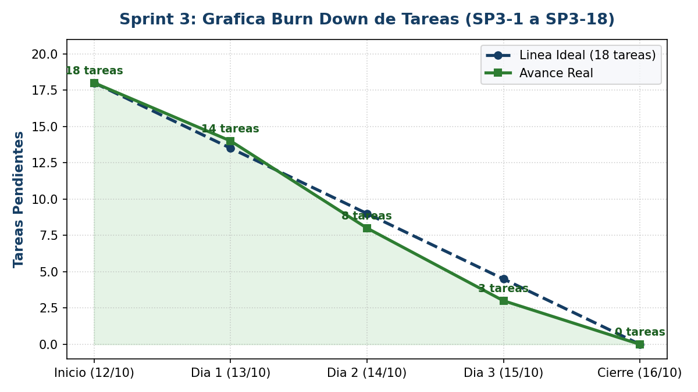

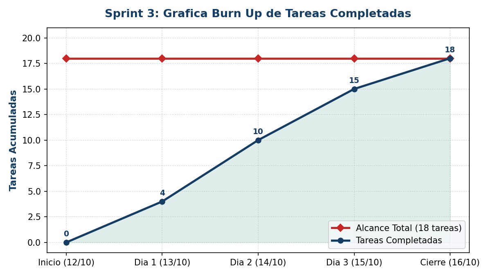

| Fecha | Pendientes ideales | Completadas ideales | Alcance total |
|---|---|---|---|
| Inicio (12/10/2026) | 18 | 0 | 18 |
| 13/10/2026 | 13.5 | 4.5 | 18 |
| 14/10/2026 | 9.0 | 9.0 | 18 |
| 15/10/2026 | 4.5 | 13.5 | 18 |
| 16/10/2026 (Cierre) | 0 | 18 | 18 |

---

## Gráfica de esfuerzos y Datos de esfuerzo.

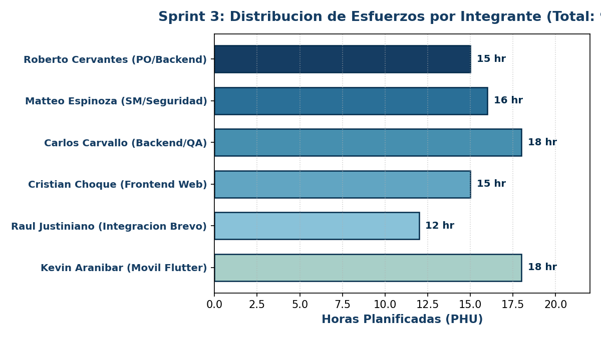

| Integrante | Horas planificadas |
|---|---|
| Roberto Cervantes | 15 hr |
| Matteo Espinoza | 16 hr |
| Kevin Aranibar | 18 hr |
| Carlos Carvallo | 18 hr |
| Cristian Choque | 15 hr |
| Raúl Justiniano | 12 hr |
| **TOTAL** | **94 hr** |

---

## Scrum TaskBoard (Backlog, to, do, doing, done)

El tablero muestra la distribución operativa y estado final de las actividades del Sprint 3. A lo largo del ciclo, todas las historias de usuario y tareas técnicas fueron transitando desde el Backlog inicial hasta culminar en estado Done tras superar los criterios de aceptación y pruebas de verificación.

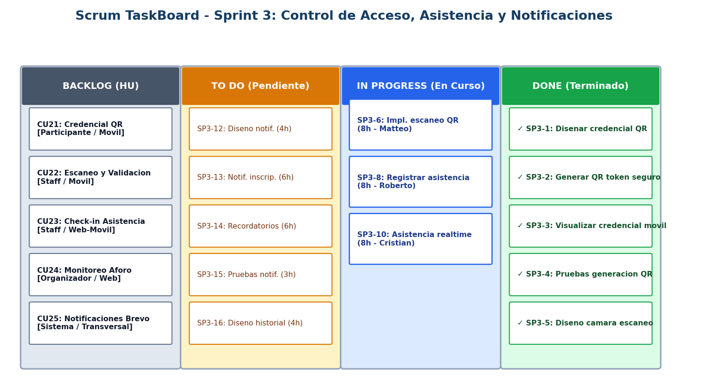
